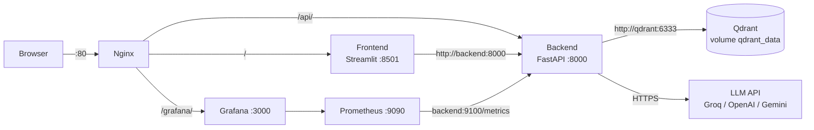

# genai-rag-app

A document Q&A app (retrieval-augmented generation, RAG). Upload a `.txt`, `.md` or `.pdf` file and ask questions about it. Every part runs in its own Docker container, Docker Compose starts them all with one command, and Nginx is the only way in.

## Architecture



| Service | Image | Role | Published port |
|---|---|---|---|
| `nginx` | `nginx:1.31.10-alpine` | Reverse proxy: `/` → frontend, `/api/` → backend, `/grafana/` → Grafana | `HTTP_PORT` (default 80) |
| `frontend` | built from `frontend/` | Streamlit page to upload documents and ask questions | none |
| `backend` | built from `backend/` | FastAPI: `/upload`, `/ask`, `/health` | none |
| `qdrant` | `qdrant/qdrant:v1.20.2` | Vector database, data in the `qdrant_data` volume | none |
| `prometheus` | `prom/prometheus:v3.16.0` | Collects request count and latency (profile `monitoring`) | none |
| `grafana` | `grafana/grafana:13.3.2` | Dashboard for those metrics (profile `monitoring`) | none |

All services share the custom bridge network `app` and reach each other by service name.

### How a question is answered

1. **Upload:** the backend extracts the text, splits it into overlapping chunks (800 characters, 100 overlap), turns each chunk into a 384-number vector with a local embedding model (`BAAI/bge-small-en-v1.5`, via fastembed) and stores the vectors in Qdrant.
2. **Ask:** the question is turned into a vector the same way, Qdrant returns the 4 closest chunks, and the LLM is asked to answer using only those chunks. The response includes the chunks as sources.
3. **Without an LLM API key,** step 2 returns the closest chunks themselves instead of a generated answer, so the app still works end to end.

## Run it

Requirements: Docker with Docker Compose.

```bash
cp .env.example .env        # then edit .env: set LLM_API_KEY (optional)
docker compose up -d --build --wait
```

Open http://localhost, upload a document and ask a question. The API docs are at http://localhost/api/docs.

```bash
docker compose logs -f backend   # follow the backend logs
docker compose down              # stop; the Qdrant data volume is kept
docker compose down -v           # stop and delete all data
```

### Monitoring (optional)

Set `GRAFANA_ADMIN_PASSWORD` in `.env` (Grafana refuses to start without it), then:

```bash
docker compose --profile monitoring up -d --build --wait
```

Open http://localhost/grafana/, log in as `admin`, and open the **GenAI RAG backend** dashboard: requests per second, p50/p95 latency, total requests and 5xx responses. The backend serves metrics on port 9100 inside the network only; they are not reachable through Nginx.

## Configuration

All settings are environment variables. Secrets go in `.env`, which Git ignores; `.env.example` lists every variable.

| Variable | Default | Purpose |
|---|---|---|
| `LLM_API_KEY` | empty | API key for the LLM. Empty: answers are the retrieved passages. |
| `LLM_BASE_URL` | `https://api.groq.com/openai/v1` | Any OpenAI-compatible chat API |
| `LLM_MODEL` | `llama-3.1-8b-instant` | Model name at that provider |
| `GRAFANA_ADMIN_PASSWORD` | empty | Required for the `monitoring` profile |
| `HTTP_PORT` | `80` | Port Nginx listens on, on the host |
| `LOG_LEVEL` | `INFO` | Backend log level |
| `CHUNK_SIZE`, `CHUNK_OVERLAP`, `TOP_K`, `MAX_UPLOAD_MB` | `800`, `100`, `4`, `10` | Retrieval and upload tuning (backend) |

## CI/CD

`.github/workflows/ci.yml` runs on every pull request and every push to `main`:

| Job | What it checks |
|---|---|
| Backend lint and tests | `ruff check`, `ruff format --check`, `pytest` (in-memory Qdrant, fake embedder and LLM) |
| Frontend lint | `ruff check`, `ruff format --check` |
| Docker images | Both images build and neither runs as root |
| Compose smoke test | Starts the stack and runs `scripts/smoke-test.sh` |
| Publish images | On `main` only: pushes `ghcr.io/<owner>/genai-rag-backend` and `genai-rag-frontend`, tagged with the commit SHA and `latest` |

## Success criteria and how they are checked

`scripts/smoke-test.sh` runs against a started stack, locally or in CI:

| Criterion | Check |
|---|---|
| Accessible only through Nginx | `/api/health` and `/` answer through Nginx; ports 8000, 8501 and 6333 are not reachable from the host |
| Upload and ask work | Uploads a document and finds its content in the answer |
| Data persists after restart | `docker compose down`, `up` again, and the same question still finds the document |
| No secrets in the repo | `.env` is in `.gitignore`; only `.env.example` (no values) is committed; images are built with `.dockerignore` excluding `.env*` |
| Pipeline passes on every push | All CI jobs above |

## Development

The backend and frontend can be linted and tested without installing Python locally:

```bash
docker run --rm -v "$PWD/backend":/app -w /app python:3.12-slim \
  sh -c "pip install -q -r requirements-dev.txt && ruff check . && pytest -q"
```

```
backend/      FastAPI app (app/), tests (tests/), Dockerfile
frontend/     Streamlit app, Dockerfile
nginx/        Reverse proxy config
monitoring/   Prometheus config, Grafana data source and dashboard
scripts/      Smoke test for a running stack
```
